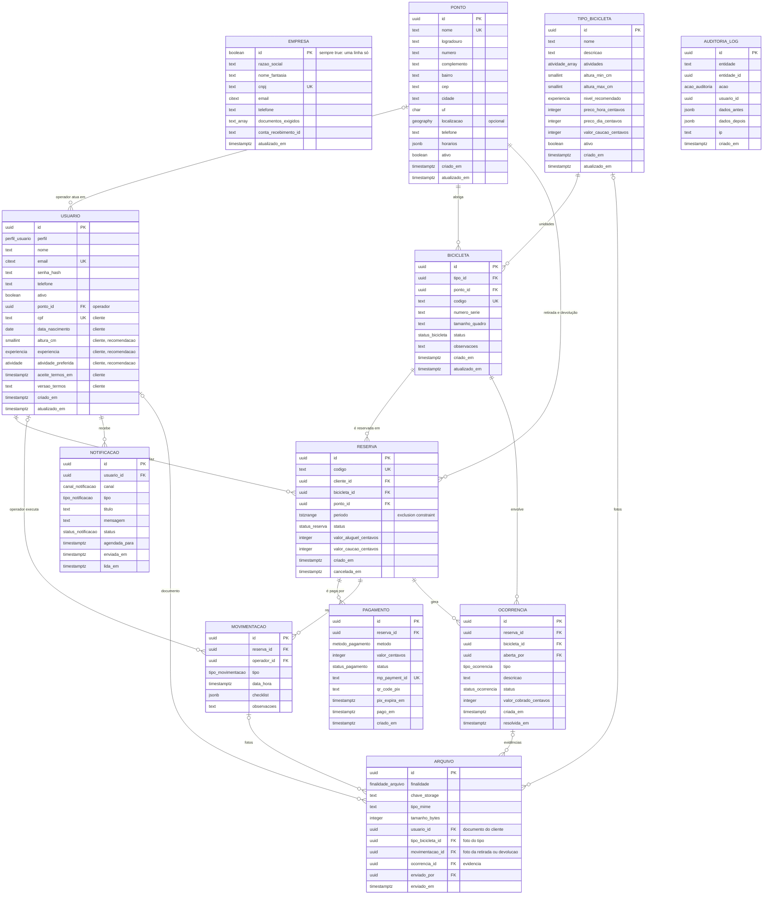

# Modelo de dados

Modelo para **uma única locadora**, com os dados que alimentam a recomendação de bicicletas.

> **Atenção: este é o modelo-alvo.** O banco hoje ainda está nas migrations `0001` a `0003`, que
> seguem o modelo anterior (várias locadoras). A seção
> [Do modelo anterior para este](#do-modelo-anterior-para-este) lista o que muda, e o plano de
> migração está em [mudanca-de-escopo.md](mudanca-de-escopo.md). Até a migration `0004` ser
> aplicada, o banco continua com a tabela `locadora`, as views e as políticas descritas no
> histórico do Git.

## Diagrama



`AUDITORIA_LOG` não tem ligação desenhada porque aponta para qualquer entidade por nome e id
(`entidade` e `entidade_id`).

## Enumerações

| Tipo | Valores |
|---|---|
| `perfil_usuario` | `CLIENTE`, `OPERADOR`, `ADMIN` |
| `experiencia` | `INICIANTE`, `INTERMEDIARIO`, `AVANCADO` |
| `atividade` | `PASSEIO`, `URBANO`, `TRILHA`, `ESPORTE`, `TURISMO` |
| `status_bicicleta` | `DISPONIVEL`, `ALUGADA`, `MANUTENCAO`, `BLOQUEADA`, `BAIXADA` |
| `status_reserva` | `PENDENTE_PAGAMENTO`, `CONFIRMADA`, `EM_ANDAMENTO`, `CONCLUIDA`, `CANCELADA`, `EXPIRADA`, `NAO_RETIRADA` |
| `metodo_pagamento` | `PIX`, `CARTAO_CREDITO`, `CARTAO_DEBITO` |
| `status_pagamento` | `PENDENTE`, `APROVADO`, `RECUSADO`, `ESTORNADO`, `EXPIRADO` |
| `tipo_movimentacao` | `RETIRADA`, `DEVOLUCAO` |
| `tipo_ocorrencia` | `DANO`, `FURTO`, `ATRASO`, `ACIDENTE`, `OUTRO` |
| `status_ocorrencia` | `ABERTA`, `EM_ANALISE`, `RESOLVIDA`, `CANCELADA` |
| `finalidade_arquivo` | `DOCUMENTO_CLIENTE`, `FOTO_TIPO_BICICLETA`, `FOTO_MOVIMENTACAO`, `EVIDENCIA_OCORRENCIA` |
| `canal_notificacao` | `WEB_PUSH`, `WHATSAPP`, `EMAIL` |
| `tipo_notificacao` | `RESERVA_CONFIRMADA`, `LEMBRETE_RETIRADA`, `LEMBRETE_DEVOLUCAO`, `PAGAMENTO_APROVADO`, `OCORRENCIA_ABERTA` |
| `status_notificacao` | `AGENDADA`, `ENVIADA`, `FALHA`, `LIDA` |
| `acao_auditoria` | `CRIACAO`, `ATUALIZACAO`, `EXCLUSAO` |

## Regras de cada tabela

### `empresa` (um único registro)

Os dados da locadora e as regras gerais. A tabela tem uma coluna `id boolean` fixa em `true`, com
`CHECK (id)` e chave primária, então o banco impede uma segunda linha. Substitui a antiga tabela
`locadora`. Não há comissão nem repasse.

### `usuario`

Clientes, operadores e administradores ficam na mesma tabela, diferenciados por `perfil`. As
constraints garantem os campos de cada perfil:

| Perfil | `ponto_id` | CPF, aceite dos termos | Dados de recomendação |
|---|---|---|---|
| `CLIENTE` | proibido | obrigatórios | altura, experiência e atividade preferida (opcionais) |
| `OPERADOR` | opcional (ponto onde atua) | proibidos | proibidos |
| `ADMIN` | proibido | proibidos | proibidos |

Os perfis `GERENTE_LOCADORA` e `ADMIN_PLATAFORMA` deixam de existir: com uma só locadora, quem
administra a loja é o `ADMIN`.

### `tipo_bicicleta`

Um "modelo" no catálogo, com tudo o que a recomendação precisa saber sobre ele:

- `altura_min_cm` e `altura_max_cm`: faixa de altura do ciclista para a qual o tipo serve
  (`altura_min_cm <= altura_max_cm`, entre 100 e 250).
- `atividades`: para o que o tipo é indicado (um ou mais valores de `atividade`).
- `nivel_recomendado`: experiência a partir da qual o tipo é confortável.
- Preços e caução em centavos inteiros (`*_centavos`), nunca em ponto flutuante.

### `bicicleta`

Uma unidade física da frota. `codigo` é o número que a locadora cola na bicicleta e é único. A
bicicleta fica em um `ponto` e só pode ser reservada quando o `status` é `DISPONIVEL`.

### `reserva`

`periodo` é um `tstzrange` (início e fim). Duas reservas ativas da mesma bicicleta não podem se
sobrepor, e quem garante isso é o banco:

```sql
ALTER TABLE reserva
  ADD CONSTRAINT reserva_sem_sobreposicao
  EXCLUDE USING gist (bicicleta_id WITH =, periodo WITH &&)
  WHERE (status IN ('PENDENTE_PAGAMENTO', 'CONFIRMADA', 'EM_ANDAMENTO'));
```

Usa a extensão `btree_gist`, já habilitada. A reserva em `PENDENTE_PAGAMENTO` segura a bicicleta até o
pagamento ser aprovado ou a reserva expirar. A retirada e a devolução são no mesmo `ponto`.

### `pagamento`

Pix ou cartão pelo Mercado Pago, em centavos. `mp_payment_id` é único, para o mesmo aviso do Mercado
Pago (webhook) não confirmar um pagamento duas vezes. Não há tabela de plano, assinatura nem repasse.

### `movimentacao`, `ocorrencia`, `arquivo`, `notificacao` e `auditoria_log`

- **`movimentacao`:** cada retirada e devolução, com o operador, o checklist (lista em `jsonb`) e as
  fotos. Uma reserva tem no máximo uma retirada e uma devolução.
- **`ocorrencia`:** dano, atraso, furto ou acidente ligados a uma reserva e a uma bicicleta, com o
  valor cobrado se houver.
- **`arquivo`:** guarda só a chave do arquivo no armazenamento privado; o conteúdo é aberto por URL
  temporária (LGPD). A coluna `finalidade` diz de que se trata, e **exatamente uma** das colunas
  `usuario_id`, `tipo_bicicleta_id`, `movimentacao_id` e `ocorrencia_id` fica preenchida.
- **`notificacao`:** avisos ao cliente por web push, WhatsApp ou e-mail.
- **`auditoria_log`:** quem alterou o quê, com os dados antes e depois, para reservas, estoque e valores.

## Dados de recomendação

A recomendação usa estes campos, e só estes (princípio de minimização da LGPD):

| Dado | Onde fica | Para que serve |
|---|---|---|
| Altura do cliente | `usuario.altura_cm` | Filtra os tipos em que ele cabe e mede o ajuste |
| Experiência | `usuario.experiencia` | Compara com o `nivel_recomendado` do tipo |
| Atividade preferida | `usuario.atividade_preferida` | Compara com as `atividades` do tipo; pode ser trocada em cada busca |
| Período e ponto da busca | informados na busca | Mostram só os tipos com unidade livre |

Regra inicial, em duas etapas:

1. **Filtro.** Entram os tipos ativos com ao menos uma bicicleta `DISPONIVEL`, sem reserva ativa que
   se sobreponha ao período, e com `altura_min_cm <= altura do cliente <= altura_max_cm`. Se o cliente
   não informou a altura, nenhum tipo é excluído por altura.
2. **Pontuação** (de 0 a 100, pesos iniciais a calibrar com a locadora):
   - **Altura (50):** 100% no centro da faixa do tipo, caindo até 0% nas pontas.
   - **Atividade (30):** 100% se a atividade pretendida está em `atividades`, senão 0%.
   - **Experiência (20):** 100% se a experiência do cliente é igual ou maior que o
     `nivel_recomendado`, senão 0%.

   O desempate é pelo menor preço por dia. Cada resultado devolve o motivo em texto.

Detalhes da implementação (`src/modules/recomendacao`, função pura `recomendar`, com testes):

- **Dado que falta não pontua.** Sem altura, ninguém ganha os 50 pontos de altura; sem atividade
  (nem na busca nem no perfil), ninguém ganha os 30; sem experiência, ninguém ganha os 20. Assim a
  ordem continua justa entre os tipos.
- **Faixa de um valor só** (`altura_min_cm = altura_max_cm`) conta como ajuste perfeito.
- **Pontos** são arredondados para inteiro. Empate de pontos e de preço por dia é desfeito pelo nome.
- **Motivos** também avisam o que pesa contra ("Não é a mais indicada para trilha", "Recomendada a
  partir do nível intermediário", altura perto do limite da faixa).
- **Preço do aluguel** (o mesmo que a reserva vai usar), assumido até a locadora confirmar: as horas
  são arredondadas para cima, cada bloco de 24 horas custa `preco_dia_centavos` e as horas que
  sobram custam `preco_hora_centavos`, limitadas ao preço de um dia.
- **Período da busca:** início e fim em ISO 8601 **com fuso**, início até 5 minutos no passado (folga
  para o tempo da requisição) e duração de 1 hora a 7 dias.

Fica para uma fase posterior usar o retorno dos clientes depois do aluguel (por exemplo, "o tamanho
ficou grande ou pequeno") para ajustar as faixas de altura de cada tipo.

## Segurança por linha

Com uma só locadora, deixa de existir o isolamento entre locadoras. A segurança por linha passa a
proteger os **dados de cada cliente**:

| Quem | O que enxerga |
|---|---|
| Visitante | Catálogo: tipos de bicicleta ativos e pontos ativos (sem dados internos) |
| Cliente | O catálogo e as próprias reservas, pagamentos e notificações |
| Operador | Tudo da operação: reservas, retiradas, devoluções e ocorrências |
| Administrador | Tudo |

O backend informa quem está logado no início de cada transação (`set_config('app.perfil', ...)` e
`set_config('app.usuario_id', ...)`, pelo helper `comSessao`). Cuidados que continuam valendo:

1. As políticas só valem para um papel **sem** `BYPASSRLS`. O dono do banco ignora a RLS; o app
   conecta com o papel `app_login`, que pertence ao grupo `app_backend` (passo a passo em
   `db/README.md`).
2. A tabela `usuario` não tem política: o login consulta a tabela antes de existir uma sessão.
3. Quem diz o perfil da sessão é o próprio backend. A RLS protege contra um filtro esquecido no
   código, mas não contra injeção de SQL ou um backend comprometido. Toda consulta precisa usar
   parâmetros.

## Decisões

- **Identificadores:** `uuid` gerado pelo banco, sem sequência numérica previsível.
- **Datas:** `timestamptz` (UTC). `atualizado_em` é mantido por trigger.
- **Dinheiro:** inteiros em centavos.
- **E-mail:** `citext`, então `Maria@x.com` e `maria@x.com` são o mesmo e-mail.
- **Dados do cliente na tabela `usuario`:** com só três perfis, as colunas de cliente ficam na própria
  tabela, com constraints que as exigem para `CLIENTE` e as proíbem para os outros perfis. Se
  crescerem, podem ir para uma tabela `cliente`.
- **Localização do ponto:** `geography(Point, 4326)` é opcional. Serve para mostrar o ponto no mapa e a
  distância até o cliente. Se a locadora tiver um ponto só, o PostGIS pode ser dispensado.
- **Documento do cliente:** só a chave do arquivo fica no banco; o arquivo fica em armazenamento privado.

## Do modelo anterior para este

| Hoje (migrations `0001` a `0003`) | No modelo novo |
|---|---|
| Tabela `locadora` (várias linhas, com CNPJ, status, comissão e conta de recebimento) | Tabela `empresa` com uma linha só; sem status, comissão nem repasse |
| `ponto.locadora_id` e nome único por locadora | Coluna removida; nome único no banco todo |
| `usuario.locadora_id` e `usuario.nivel_acesso` | Colunas removidas |
| Perfis `CLIENTE`, `OPERADOR`, `GERENTE_LOCADORA` e `ADMIN_PLATAFORMA` | Perfis `CLIENTE`, `OPERADOR` e `ADMIN` |
| `usuario.altura_cm` | Mantida; entram `experiencia` e `atividade_preferida` |
| Views `locadora_catalogo` e `locadora_equipe` | Removidas |
| Políticas de RLS de `locadora` e `ponto`; funções `sessao_locadora_id`, `locadora_esta_ativa` e `locadora_protege_campos` | Removidas; novas políticas por cliente em reserva, pagamento e notificação |
| Papel `app_backend` e tabela `limite_tentativas` | Mantidos (as permissões são ajustadas) |
| Ainda não existiam: tipo de bicicleta, bicicleta, reserva, pagamento, movimentação, ocorrência, arquivo, notificação e auditoria | Entram nas migrations seguintes, junto de cada módulo |
| Tabelas previstas no modelo anterior e que **não** serão criadas: plano, assinatura e repasse | Fora do escopo |
