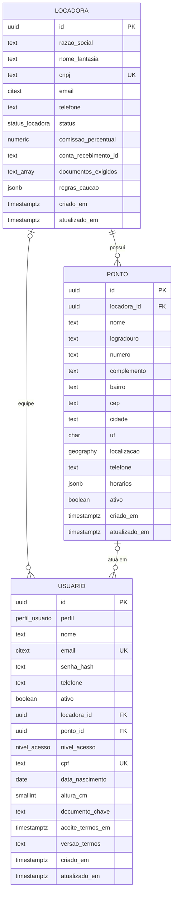

# Modelo de dados

Esquema inicial do banco (migration `db/migrations/0001_schema_inicial.sql`): usuário, locadora e
ponto. As demais tabelas (bicicletas, reservas, pagamentos etc.) entram em migrations seguintes.

## Diagrama



## Relacionamentos

| Relação | Cardinalidade | Observação |
|---|---|---|
| locadora → ponto | 1 para N | Uma locadora tem um ou mais pontos. Não é possível apagar uma locadora que tenha pontos. |
| locadora → usuario | 1 para N (opcional) | Só a equipe da locadora (operador e gerente) tem `locadora_id`. |
| ponto → usuario | 1 para N (opcional) | O operador pode estar fixo em um ponto. O ponto precisa ser da mesma locadora do usuário. |

## Um usuário, vários perfis

Clientes, equipe das locadoras e administradores ficam na mesma tabela `usuario`, diferenciados por
`perfil`. As constraints do banco garantem os campos de cada perfil:

| Perfil | `locadora_id` | `nivel_acesso` | CPF e aceite dos termos |
|---|---|---|---|
| `CLIENTE` | proibido | proibido | obrigatórios |
| `OPERADOR` | obrigatório | proibido | proibidos |
| `GERENTE_LOCADORA` | obrigatório | proibido | proibidos |
| `ADMIN_PLATAFORMA` | proibido | obrigatório | proibidos |

## Decisões

- **Identificadores:** `uuid` gerado pelo banco, sem sequência numérica previsível.
- **Datas:** `timestamptz` (guardadas em UTC). `atualizado_em` é mantido por trigger.
- **E-mail:** `citext`, então `Maria@x.com` e `maria@x.com` são o mesmo e-mail.
- **Endereço do ponto:** colunas na própria tabela (é um dado que sempre acompanha o ponto).
- **Localização:** `geography(Point, 4326)` com índice GIST, para buscar as locadoras mais próximas
  com `ST_DWithin` e ordenar com `ST_Distance`. Atenção: `ST_MakePoint(longitude, latitude)`.
- **Documento do cliente:** o banco guarda só a chave do arquivo (`documento_chave`). O arquivo fica em
  armazenamento privado e é aberto por URL temporária (LGPD).
- **Valores livres em JSON:** `regras_caucao` e `horarios` ainda não têm formato fechado, então ficam
  em `jsonb` com uma checagem do tipo (objeto e lista).
- **Comissão:** `comissao_percentual` é nula até o modelo de comissão ser definido.

## Segurança por linha (multilocação)

`locadora` e `ponto` têm *row-level security*. O backend informa quem está logado no início de cada
transação:

```sql
SELECT set_config('app.perfil', 'GERENTE_LOCADORA', true),
       set_config('app.locadora_id', '<uuid da locadora>', true);
```

| Quem | locadora | ponto |
|---|---|---|
| Visitante ou cliente | vê as locadoras `ATIVA` | vê os pontos ativos de locadoras `ATIVA` |
| Operador | vê a própria locadora | vê os pontos da própria locadora |
| Gerente | vê e edita a própria locadora (menos CNPJ, status, comissão e conta de recebimento) | vê e edita os pontos da própria locadora |
| Admin da plataforma | tudo | tudo |

Dois cuidados:

1. As políticas só valem para um papel **sem** `BYPASSRLS`. O dono do banco (`neondb_owner`) ignora
   a RLS, então o backend precisa conectar com um papel próprio, que ainda será criado.
2. A tabela `usuario` ainda não tem política: o login consulta a tabela antes de existir uma sessão.
   Isso será resolvido no módulo de contas.
